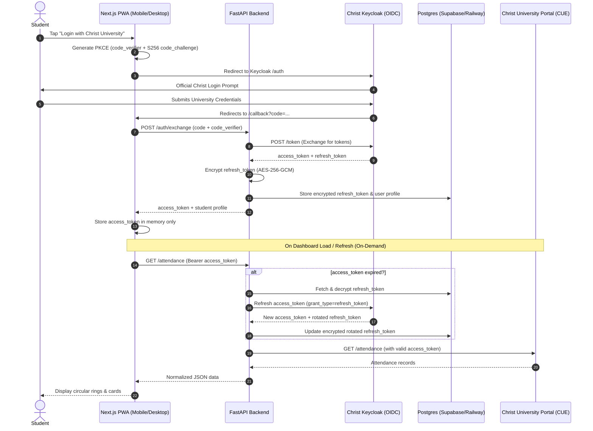

# Christ Attendance Viewer 🎓📱

A clean, mobile-first Progressive Web App (PWA) designed for **Christ (Deemed to be University)** students to log in securely with their university credentials and view attendance and marks in a fast, beautiful dashboard.

---

## ✨ Features

- **🛡️ Secure OIDC Keycloak Authentication with PKCE**:
  - Authorization code flow with SHA-256 code challenge (`code_verifier` + `code_challenge`).
  - No passwords ever touch or pass through application servers.
  - Refresh tokens encrypted with **AES-256-GCM** at rest in PostgreSQL.
  - Access tokens stored **strictly in-memory** (never in `localStorage` or `sessionStorage`).
- **⭕ Circular Progress Rings**:
  - Live SVG progress rings color-coded to university thresholds:
    - 🟢 **Safe Zone (≥ 85%)** — Emerald
    - 🟡 **Warning Zone (75% – 84%)** — Amber
    - 🔴 **Critical Shortage (< 75%)** — Rose
- **⏱️ On-Demand Refresh**:
  - Fetches only when the app opens or when the student taps refresh.
  - Real-time "Last updated: X seconds ago" counter.
  - Zero background battery drain (no polling, no background cron jobs).
- **🧮 Interactive "What-If" Calculator**:
  - Target slider (60% to 95%, default 85%).
  - Accurate calculation of safe skips:
    $$\text{can\_skip} = \max\left(0, \left\lfloor\frac{\text{attended} - \text{target} \times \text{total}}{\text{target}}\right\rfloor\right)$$
  - Classes needed to reach minimum threshold:
    $$\text{need} = \max\left(0, \left\lceil\frac{\text{target} \times \text{total} - \text{attended}}{1 - \text{target}}\right\rceil\right)$$
  - Real-time per-subject attendance simulation steppers.
- **📊 Marks Breakdown**:
  - Interactive component charts (Recharts) for CIA 1, CIA 2 (Mid-Sem), CIA 3, and Attendance Marks.
  - Overall GPA card with semester tracking.
- **📲 Progressive Web App (PWA)**:
  - Add to Home Screen banner for iOS Safari and Android Chrome.
  - Full-screen standalone display with safe area notch insets (`viewport-fit=cover`).
  - Offline app shell caching via Service Worker (`sw.js`).
- **🌓 Dark Mode by Default**:
  - Deep slate aesthetic inspired by Linear and Vercel.
  - Instant theme switcher.

---

## 🏗️ Architecture & Auth Flow



---

## 📂 Project Structure

```text
├── backend/
│   ├── main.py            # FastAPI entrypoint, endpoints, rate limiting & CORS
│   ├── auth.py            # Keycloak OIDC PKCE token exchange & refresh logic
│   ├── crypto.py          # AES-256-GCM encryption & decryption for tokens
│   ├── db.py              # PostgreSQL (asyncpg) / SQLite async engine & models
│   ├── models.py          # Pydantic schemas (Attendance, Marks, Auth)
│   ├── portal.py          # Christ University portal parser & fallbacks
│   ├── requirements.txt   # Python dependencies
│   ├── .env.example       # Backend environment configuration
│   └── .env               # Active backend configuration
│
├── frontend/
│   ├── app/
│   │   ├── page.tsx          # Landing page with login & demo preview
│   │   ├── callback/page.tsx # OAuth PKCE redirect handler & exchange
│   │   ├── dashboard/page.tsx# Main dashboard (ring, subject cards, timetable)
│   │   ├── marks/page.tsx    # Marks breakdown & Recharts bar chart
│   │   ├── calculator/page.tsx# "What-if" attendance simulator
│   │   ├── layout.tsx        # Root layout, PWA viewport, service worker
│   │   └── globals.css       # Tailwind directives & theme tokens
│   ├── components/
│   │   ├── AttendanceRing.tsx    # Animated SVG circular percentage ring
│   │   ├── SubjectCard.tsx       # Subject card with skip/need calculation
│   │   ├── TodayClasses.tsx      # Daily class timeline with status badges
│   │   ├── BottomNav.tsx         # Mobile-first sticky tab navigation
│   │   ├── Navbar.tsx            # Header with student info & refresh button
│   │   ├── SkeletonLoader.tsx    # Shimmer loaders
│   │   └── PWAInstallPrompt.tsx  # Add to Home Screen banner (iOS & Android)
│   ├── lib/
│   │   ├── auth.ts          # Web Crypto PKCE generator & in-memory token store
│   │   ├── api.ts           # FastAPI backend fetch client
│   │   └── calculations.ts  # Attendance math, skip counters & forecast formulas
│   ├── public/
│   │   ├── manifest.json    # PWA manifest
│   │   ├── sw.js            # Service worker for shell caching
│   │   └── icons/           # PWA icons (192px, 512px)
│   ├── package.json
│   ├── tailwind.config.js
│   ├── tsconfig.json
│   └── .env.local
│
├── .gitignore
└── README.md
```

---

## 🚀 Getting Started

### 1. Prerequisites
- **Node.js**: v18 or later (v20+ recommended)
- **Python**: 3.10+
- **PostgreSQL**: (or SQLite for zero-setup local dev)

---

### 2. Backend Setup

```bash
cd backend

# Create virtual environment
python3 -m venv venv
source venv/bin/activate  # On Windows: venv\Scripts\activate

# Install dependencies
pip install -r requirements.txt

# Configure environment variables
cp .env.example .env
# Edit .env with your PostgreSQL database or use default SQLite

# Start FastAPI development server
uvicorn main:app --reload --host 0.0.0.0 --port 8000
```

The backend will be running at `http://localhost:8000`.
- API Docs: `http://localhost:8000/docs`
- Health check: `http://localhost:8000/health`

---

### 3. Frontend Setup

```bash
cd frontend

# Install dependencies
npm install

# Start Next.js development server
npm run dev
```

Open `http://localhost:3000` in your browser.

---

## 🔒 Security Hardening

1. **Passwords**: Never handled or stored. Keycloak handles authentication directly.
2. **Refresh Tokens**: Encrypted at rest using **AES-256-GCM** with authenticated 96-bit nonces.
3. **Access Tokens**: Kept exclusively in JavaScript memory; wiped on tab close or session expiration.
4. **Rate Limiting**: `POST /auth/exchange` is protected by `slowapi` rate limiting (max 5 requests/minute per IP).
5. **No Token Logging**: Zero logging of tokens, client secrets, or student credentials in standard stdout.

---

## 🚢 Deployment

### Backend (FastAPI on Railway or Render)
1. Set the root directory to `/backend`.
2. Set Build Command: `pip install -r requirements.txt`
3. Set Start Command: `uvicorn main:app --host 0.0.0.0 --port $PORT`
4. Set Environment Variables:
   - `KEYCLOAK_BASE_URL=https://studentespro.christuniversity.in`
   - `KEYCLOAK_REALM=Student`
   - `KEYCLOAK_CLIENT_ID=react-app`
   - `KEYCLOAK_REDIRECT_URI=https://<your-frontend-domain>/callback`
   - `PORTAL_API_BASE=https://cue.christuniversity.in`
   - `DATABASE_URL=postgresql+asyncpg://<user>:<password>@<host>:5432/<dbname>`
   - `TOKEN_ENCRYPTION_KEY=<generated-32-byte-base64-key>`
   - `FRONTEND_URL=https://<your-frontend-domain>`

### Frontend (Next.js on Vercel)
1. Import root repository and set the Root Directory to `frontend`.
2. Framework Preset: Next.js.
3. Set Environment Variables:
   - `NEXT_PUBLIC_API_URL=https://<your-backend-domain>`
   - `NEXT_PUBLIC_KEYCLOAK_URL=https://studentespro.christuniversity.in/auth/realms/Student/protocol/openid-connect/auth`
   - `NEXT_PUBLIC_CLIENT_ID=react-app`
   - `NEXT_PUBLIC_REDIRECT_URI=https://<your-frontend-domain>/callback`

---

## 📱 Installing the PWA

### iOS (Safari)
1. Open the app in Safari.
2. Tap the **Share** button (box with an arrow pointing up) at the bottom.
3. Scroll down and select **"Add to Home Screen"**.
4. Tap **Add**. The app will now launch full-screen like a native iOS application.

### Android (Chrome)
1. Open the app in Chrome.
2. Tap the **"Add to Home Screen"** banner or open the three-dot menu and select **"Install app"**.
